<!-- Profile README · ThiagoKaoru/ThiagoKaoru -->

<p align="center">
  
</p>

<p align="center">
  <strong>Engineer at heart. Curious by default.</strong><br />
  I build reliable products, simplify complex systems, and explore better ways to create software.
</p>

<p align="center">
  <a href="#what-i-do">What I do</a> &nbsp;·&nbsp;
  <a href="#toolbox">Toolbox</a> &nbsp;·&nbsp;
  <a href="#currently-exploring">Now exploring</a>
</p>

---

### What I do

I'm a **Senior Software Engineer at Arco**, passionate about building scalable products, solving complex problems, and improving how software is built.

I work across the stack, from crafting great user experiences to designing reliable backend services and distributed systems.

- Building and evolving products in **education technology**.
- Working with **TypeScript, React, Next.js, Node.js, Go, PostgreSQL, Redis, Kafka, GCP, and Kubernetes**.
- Interested in **software architecture, performance optimization, observability, and developer experience**.
- Exploring **AI agents, LLM orchestration, and developer tooling** to make engineering workflows smarter and more efficient.

### What I'm into lately

<table>
  <tr>
    <td width="50%" valign="top">
      <h3>01 / Backend &amp; architecture</h3>
      <p>Distributed systems, API design, reliability, and scalability.</p>
    </td>
    <td width="50%" valign="top">
      <h3>02 / Frontend engineering</h3>
      <p>React, Next.js, web performance, and modern application architecture.</p>
    </td>
  </tr>
  <tr>
    <td width="50%" valign="top">
      <h3>03 / AI engineering</h3>
      <p>Coding agents, agentic workflows, tooling, and automation.</p>
    </td>
    <td width="50%" valign="top">
      <h3>04 / Engineering excellence</h3>
      <p>Observability, testing strategies, performance, and developer productivity.</p>
    </td>
  </tr>
</table>

### Toolbox

<p align="left">
  
</p>

`Frontend & product` · `Backend & APIs` · `Distributed systems` · `Cloud & observability`

### Currently exploring

```text
~/lab
├── agentic-workflows/       # Orchestration, tools, evaluation
├── developer-experience/    # Less friction, better feedback loops
├── system-design/           # Reliability, performance, architecture
└── side-quests/             # Whatever sparks curiosity
```

### Beyond the terminal

When I'm not coding, you'll probably find me taking photos, traveling, exploring new gadgets, or hanging out with my four dogs.

<sub>Based in Brazil · he/him · Always learning, always building.</sub>
